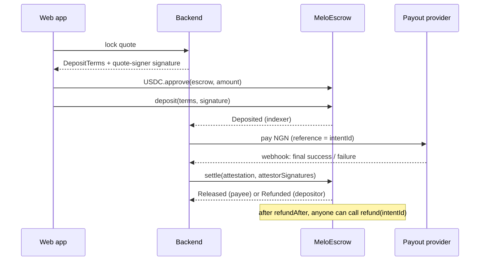

# @melo/contracts

`MeloEscrow`: holds a user's USDC per cash-out intent until the NGN payout is attested.
Success releases to the payee fixed at deposit (the MELO treasury); failure or timeout refunds the user.

Status: `PROPOSED` (handbook ADR-0003, ADR-0006, ADR-0010). Testnet only until an independent review.

| Chain | Chain ID | USDC (ERC-20) | Gas |
|---|---|---|---|
| Arc Testnet | 5042002 | `0x3600000000000000000000000000000000000000` | USDC, `maxFeePerGas` ≥ 20 gwei |
| Base Sepolia | 84532 | `0x036CbD53842c5426634e7929541eC2318f3dCF7e` | ETH |

## Flow



Per-intent state: `NONE → ESCROWED → RELEASED | REFUNDED`. Terminal states are final.

| Function | Who | Rules |
|---|---|---|
| `deposit(terms, sig)` | the depositor named in `terms` | signed by `quoteSigner`; before `quoteExpiry`; token accepted and `0 < amount ≤ cap`; `refundAfter` 30 min–24 h ahead (backend default: 2 h); unused `intentId`; balance must rise by exactly `amount`; blocked by pause |
| `settle(att, sigs)` | anyone (MELO relayer) | ≥ `threshold` distinct attestor signatures, sorted by signer address ascending; not expired; outcome `1` releases to `payee`, `2` refunds the depositor; blocked by pause; still valid after `refundAfter` while escrowed (first of settle/refund wins) |
| `refund(intentId)` | anyone | once `block.timestamp ≥ refundAfter`; **never blocked by pause** |
| admin | owner (multisig outside testnet) | rotate quote signer / attestors, threshold, token caps, pause, sweep surplus (never escrowed funds); `renounceOwnership` disabled; ownership moves via `Ownable2Step` |

Signatures are EIP-712 with domain `{ name: "MeloEscrow", version: "1", chainId, verifyingContract }`,
so a signature for one chain or deployment is useless on another. `intentId` can be used once per
deployment, which is what prevents replay.

Known behaviours:
- A USDC-blocklisted depositor or payee makes the matching transfer revert; funds stay escrowed.
- The contract uses only USDC's ERC-20 interface (6 decimals). It has no `receive`/`payable` and no `SELFDESTRUCT`.
- No upgrade proxy. Changes ship as a new deployment; the old one is left to drain.

## Commands

```bash
npm install
npm test               # 28 tests: unit, signature, race, admin, randomized invariants
npm run typecheck
npm run export         # regenerate exports/ from artifacts + deployments/
```

## Deploying (testnet)

Keys never go in the repo. Use Hardhat's encrypted keystore:

```bash
npx hardhat keystore set DEPLOYER_PRIVATE_KEY
npx hardhat keystore set ARC_TESTNET_RPC_URL      # https://rpc.testnet.arc.io
npx hardhat keystore set BASE_SEPOLIA_RPC_URL     # https://sepolia.base.org
```

Role addresses are public and passed as env vars:

```bash
export ESCROW_OWNER=0x...            # must later call acceptOwnership() if not the deployer
export QUOTE_SIGNER_ADDRESS=0x...
export ATTESTOR_ADDRESSES=0x...      # comma-separated
export ATTESTOR_THRESHOLD=1          # testnet; mainnet needs >= 2 (ADR-0006)

npx hardhat run scripts/deploy.ts    # rehearsal on the in-memory chain, writes nothing
npm run deploy:arc
npm run deploy:base
npm run export
```

Fund the deployer first: Arc Testnet USDC and Base Sepolia USDC from [faucet.circle.com](https://faucet.circle.com), plus Base Sepolia ETH for gas.
Each deploy writes `deployments/<chainId>.json` (address, deploy block, roles). Commit it.

## Backend handoff

The backend (separate repo) and `web/` import only `exports/`:

| Export | Use |
|---|---|
| `meloEscrowAbi` | typed viem/wagmi contract calls and log decoding |
| `escrowDeployments[chainId]` | `{ escrow, usdc, deployBlock }` per chain |
| `depositTermsTypes`, `attestationTypes`, `meloEscrowDomain()` | EIP-712 signing that matches the contract byte for byte |
| `OUTCOME`, `REFUND_REASON`, `ESCROW_STATUS` | enum values |

Backend components that touch the contract:

1. **Quote signer**: on quote lock, builds `DepositTerms` (`intentId`, depositor wallet, USDC, amount in base units, treasury payee, `recipientCommitment = keccak256(bankCode|account|salt)`, `quoteExpiry`, `refundAfter = now + 2h`) and signs it. Returned by `GET /intents/{id}/authorization`.
2. **Indexer**: reads `Deposited` / `Released` / `Refunded` from `deployBlock`, keeps a cursor per chain, dedupes by `(chainId, txHash, logIndex)`. Arc is final after 1 block.
3. **Payout worker**: on `Deposited`, calls the provider adapter with `intentId` as the idempotent reference.
4. **Attestor**: on a final provider outcome, signs `Attestation { intentId, outcome, evidenceHash, expiry }`. Key in a KMS. Never signs an unknown outcome.
5. **Relayer**: submits `settle`. Pays gas in USDC on Arc (≥ 20 gwei `maxFeePerGas`) and ETH on Base.
6. **Reconciler**: compares `getEscrow(intentId)` with the database and flags drift.

The quote-signer key, the attestor key(s) and the owner must be different keys.
