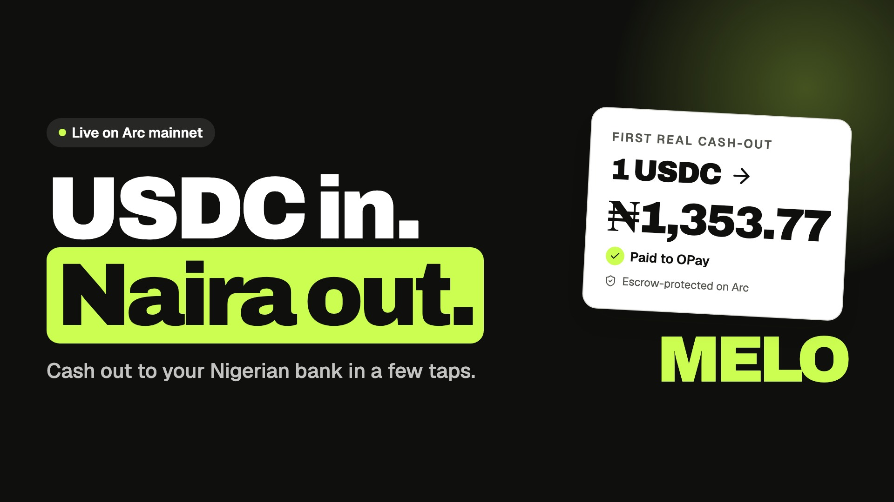
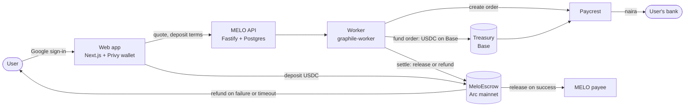
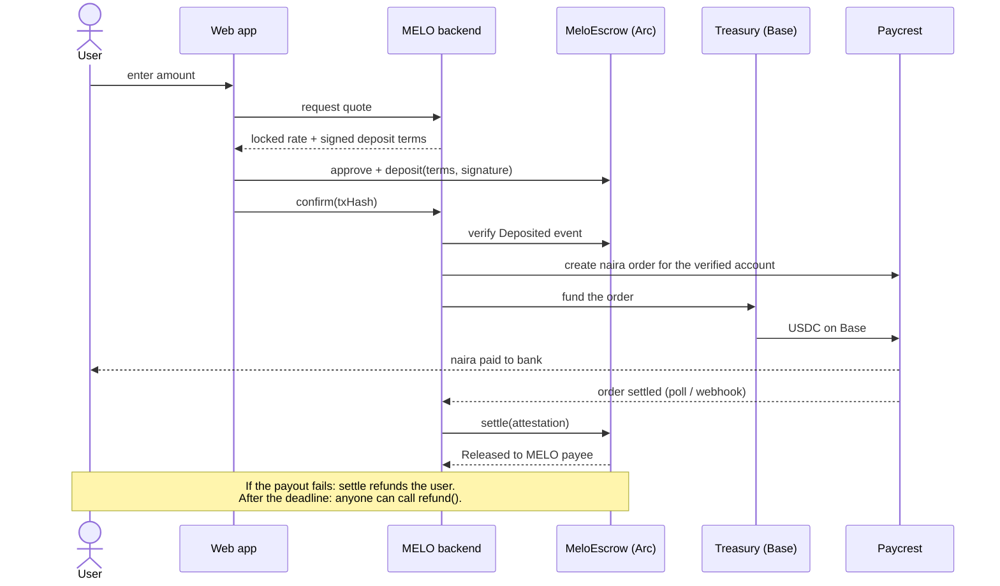
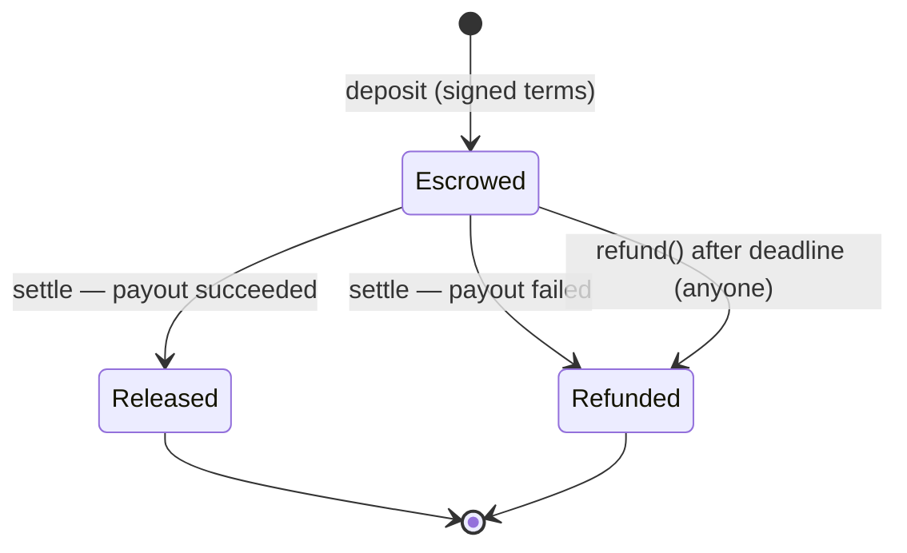

# MELO — USDC in. Naira out.

Cash out USDC to your Nigerian bank account in a few taps. Your USDC waits in an escrow contract on **Arc**
and is released only after the naira lands in your bank. If the payout fails, you're refunded.

**Live app:** [melo.usevince.xyz](https://melo.usevince.xyz) · **Escrow on Arc mainnet:**
[`0x52e991BeAbEB2DBF9D7090Dcba8AC943D6Ce1A30`](https://explorer.arc.io/address/0x52e991BeAbEB2DBF9D7090Dcba8AC943D6Ce1A30)

## Watch the 90-second pitch

[](https://youtu.be/Q-JWqXVOVYg)

▶ [youtu.be/Q-JWqXVOVYg](https://youtu.be/Q-JWqXVOVYg)

## Contents

- [The problem](#the-problem)
- [The solution](#the-solution)
- [How MELO uses Arc](#how-melo-uses-arc)
- [Architecture](#architecture)
- [Proof: first mainnet cash-out](#proof-first-mainnet-cash-out)
- [Trust model and current limits](#trust-model-and-current-limits)
- [Repository and docs](#repository-and-docs)
- [Run it locally](#run-it-locally)
- [Resources](#resources)

## The problem

More Nigerians are paid in USDC: freelancers, remote workers, creators, families receiving money from abroad.
Getting paid on-chain is easy. Turning it into naira in a bank account is not:

- **P2P desks mean trusting a stranger.** You send your USDC first, then wait for a bank transfer and hope it
  arrives. If the trader delays or disappears, you have no protection and no one to call.
- **Exchanges add friction.** Accounts, ID checks, several transfers, and wide buy/sell spreads to get your own money out.
- **Wallets are hard for non-crypto users.** Seed phrases, buying a separate token for fees, choosing the right network.

There is no simple way to say: *"take my USDC only if my naira actually arrives."*

## The solution

MELO replaces trust in a stranger with an escrow contract.

1. **Sign in with Google.** A wallet is created for you ([Privy](https://www.privy.io)); no seed phrase.
2. **Add your bank account once.** The account name is verified before it can receive payouts.
3. **Enter an amount.** MELO locks the rate and signs the deposit terms before you send anything.
4. **Your USDC goes into escrow on Arc**, not to a person.
5. **Naira is paid to your bank** through the [Paycrest](https://paycrest.io) payment network.
6. **The escrow releases only after the payout is confirmed.** If it fails, the escrow refunds you. If MELO ever
   went offline, you can pull your USDC back yourself after the deadline; no permission needed.

Fee: 0.3%, shown before you confirm.

## How MELO uses Arc

| What | Why Arc |
| --- | --- |
| **User wallets hold USDC on Arc** | Users keep one asset. On Arc, gas is paid in USDC, so nobody has to buy a second token just to cash out. |
| **`MeloEscrow` is deployed on Arc mainnet** | Deposits, releases and refunds are enforced by the contract, not by MELO's promise. |
| **Signed quotes are checked on-chain** | `deposit()` only accepts terms signed by MELO's quote signer (EIP-712, bound to chain and contract), before the quote expires. |
| **Settlement on Arc** | MELO's attestor signs the payout outcome; `settle()` releases USDC to MELO's treasury on success or refunds the user on failure. |
| **Permissionless refund** | `refund()` works for anyone after the deadline and is never blocked by pause, so funds can't be stuck if MELO disappears. |
| **Public proof** | Every deposit, release and refund is visible on the [Arc explorer](https://explorer.arc.io). |

Paycrest takes orders funded with USDC on Base, so MELO's treasury pays each order on Base and is repaid on Arc when the
escrow releases.

**Arc mainnet deployment** (chain ID `5042`, from [`contracts/deployments/5042.json`](contracts/deployments/5042.json)):

| | Address |
| --- | --- |
| MeloEscrow | [`0x52e991BeAbEB2DBF9D7090Dcba8AC943D6Ce1A30`](https://explorer.arc.io/address/0x52e991BeAbEB2DBF9D7090Dcba8AC943D6Ce1A30) |
| USDC (native gas token) | `0x3600000000000000000000000000000000000000` |
| Deploy transaction | [`0x28f38a21…bd688`](https://explorer.arc.io/tx/0x28f38a21a8c5592ff55547f1343f5cdd722dea619868d963453fa6a4e1fbd688) |

## Architecture



### One cash-out, step by step



### Escrow states



## Proof: first mainnet cash-out

| Step | Result |
| --- | --- |
| Deposit | 1 USDC escrowed on Arc mainnet |
| Payout order funded | 0.997 USDC on Base, [`0x8c8b…1ba8`](https://basescan.org/tx/0x8c8bcab5f3e7c85cc360720a0b8eefd0fab9ef19d0b7cd05580ac708c1ad1ba8) (1 USDC minus the 0.3% fee) |
| Naira paid | **₦1,353.77** to an OPay account |
| Escrow released | Arc, [`0x6b36…6c02`](https://explorer.arc.io/tx/0x6b3688b195debad98d98ff5c04493247fd1ccd1865ef034ec4e492e1319f6c02) |

## Trust model and current limits

Being explicit about what is and isn't trustless today:

- **Trustless:** funds sit in the contract, not with MELO; a deposit only matches terms MELO signed; after the
  deadline the user can always refund, even if MELO is offline or the contract is paused.
- **Trusted:** the release decision. One MELO attestor key signs the payout outcome (threshold `1`). The plan is
  two or more independent attestors and keys in a KMS.
- **Caps while in beta:** at most **2 USDC per deposit** on mainnet (contract `maxAmount`).
- **Not audited.** The contract has 28 tests (unit, signature, race, admin, randomized invariants) but no independent review yet.

## Repository and docs

| Path | What it is | Docs |
| --- | --- | --- |
| [`web/`](web) | Next.js app: Google sign-in, wallet balances, cash-out flow, live tracker, `/admin` operations dashboard | [`web/PRODUCT.md`](web/PRODUCT.md), [`web/DESIGN.md`](web/DESIGN.md) |
| [`backend/`](backend) | Fastify API and worker: accounts, verified bank accounts, quotes, deposits, payouts, treasury funding, settlement | [`backend/README.md`](backend/README.md) (API reference, worker flow, security rules) |
| [`contracts/`](contracts) | `MeloEscrow` (Hardhat): contract, tests, deployments | [`contracts/README.md`](contracts/README.md) (functions, roles, signatures) |
| [`scripts/`](scripts) | `npm run dev` / `npm run live` helpers | |
| Engineering handbook | Architecture decisions (ADRs) and design notes | [`MELO Engineering Handbook — Workbook.html`](<MELO Engineering Handbook — Workbook.html>) (download and open in a browser) |

Stack: TypeScript everywhere · Next.js 16, React, wagmi/viem, Privy · Node 24, Fastify, PostgreSQL, graphile-worker ·
Solidity + Hardhat, OpenZeppelin · Paycrest sender API · hosted on a VPS behind nginx with TLS.

## Run it locally

```bash
npm install --prefix backend && npm install --prefix web
cp backend/.env.example backend/.env    # fill in Privy keys and DATA_ENCRYPTION_KEY
cp web/.env.example web/.env.local
npm run dev                             # Postgres, migrations, API, worker and web in one terminal
npm test                                # backend tests against a local Postgres
```

Payouts are simulated by default (`PAYOUT_PROVIDER=simulated`). See [`backend/README.md`](backend/README.md) for the
real Paycrest and treasury settings, and [`contracts/README.md`](contracts/README.md) for deploying the escrow.

## Resources

- [Arc documentation](https://docs.arc.network) and [Arc explorer](https://explorer.arc.io)
- [USDC by Circle](https://www.circle.com/usdc) and the [Circle faucet](https://faucet.circle.com) for testnet USDC
- [Paycrest documentation](https://docs.paycrest.io)
- [Privy documentation](https://docs.privy.io)
- [EIP-712: typed structured data signing](https://eips.ethereum.org/EIPS/eip-712)
